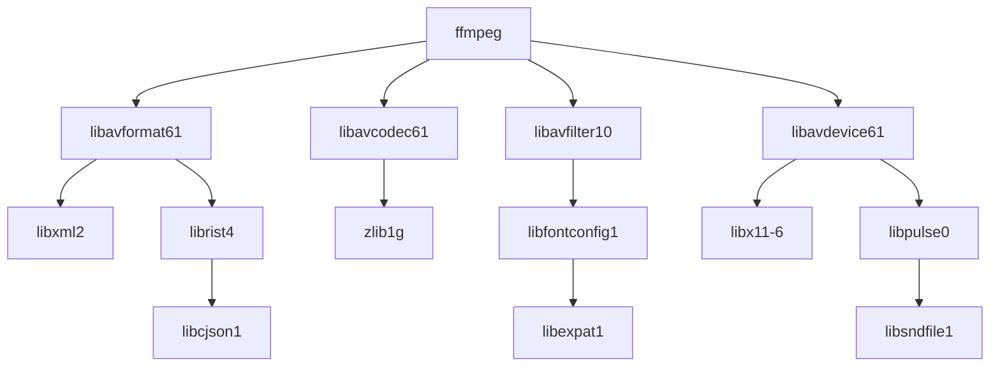

# SEC-01: diagnóstico del sistema operativo de CI

Fecha de consulta: 2026-11-09. Alcance: imagen de pruebas Debian 13 `trixie`,
Linux/amd64; ninguna imagen, configuración o instalación operativa se utiliza.
El diagnóstico no autoriza publicación ni convierte un scanner bloqueado en verde.

## Evidencia de entrada conservada

La imagen CI-01 analizada es
`sha256:740f08d13d6c5899fe26aabe892db87f08f6682f1153589a0b86ec8d4cdb9f33`.
Se leyeron exclusivamente los informes de `.ci-local/ci01-ba2ee8bc/`:

| Archivo inmutable | SHA-256 |
|---|---|
| `trivy-high-critical.json` | `6dae32d8a5db469e59757dbd7ecc6e770829f014492e9a1c8fb41391f733d07d` |
| `sbom.cdx.json` | `e251b47e132f05a5f0f827d6d1fd2503b388e4f16416e7beb698e8f8286c2239` |

Los artefactos derivados de esta revisión están en
`.ci-local/sec01-06e7d342/infra/`: `os-source-groups.json`,
`sbom-dependency-paths.json`, `baseline-input-hashes.json`,
`dpkg-sbom-crosscheck.json` y `browser-os-prerequisites-baseline.json`.
La matriz oficial completa de CVEs se mantiene por separado en
`SEC-01-matrix.md`; este documento explica procedencia, dependencias y el cambio
mínimo posible en APT.

## Agrupación completa del baseline OS

Los 228 hallazgos HIGH/CRITICAL de Debian se distribuyen entre 37 paquetes
binarios, 16 paquetes fuente y 54 CVEs distintos. La unidad hallazgo cuenta una
combinación paquete binario/CVE: 153 hallazgos de FFmpeg corresponden a 17 CVEs
replicados entre nueve binarios, no a 153 CVEs diferentes.

| Paquete fuente | Versión fuente instalada | Binarios afectados | CVEs | Hallazgos |
|---|---|---:|---:|---:|
| acl | 2.3.2-2 | 1 | 1 | 1 |
| cjson | 1.7.18-3.1+deb13u1 | 1 | 5 | 5 |
| expat | 2.9.0-1~deb13u1 | 1 | 4 | 4 |
| ffmpeg | 7:7.1.5-0+deb13u1 | 9 | 17 | 153 |
| libsndfile | 1.2.2-2+deb13u1 | 1 | 1 | 1 |
| libx11 | 2:1.8.12-1 | 3 | 1 | 3 |
| libxi | 2:1.8.2-1 | 1 | 2 | 2 |
| libxml2 | 2.12.7+dfsg+really2.9.14-2.1+deb13u3 | 1 | 8 | 8 |
| libxrender | 1:0.9.12-1 | 1 | 1 | 1 |
| ncurses | 6.5+20250216-2 | 4 | 1 | 4 |
| perl | 5.40.1-6+deb13u1 | 1 | 1 | 1 |
| sqlite3 | 3.46.1-7+deb13u2 | 1 | 3 | 3 |
| systemd | 257.13-1~deb13u1 | 2 | 1 | 2 |
| tiff | 4.7.0-3+deb13u3 | 1 | 2 | 2 |
| util-linux | 2.41.5-0+deb13u1 | 9 | 4 | 36 |
| zlib | 1:1.3.dfsg+really1.3.1-1 | 1 | 2 | 2 |

El mapeo fuente se tomó de `Results.Packages` de Trivy y las relaciones del SBOM
CycloneDX. Se preservan los epochs Debian; las versiones de los binarios pueden
incluir un sufijo de reconstrucción, por ejemplo `zlib1g` termina en `-1+b1`
mientras su paquete fuente termina en `-1`.
El inventario `baseline-dpkg.tsv`, obtenido por el coordinador desde la imagen
de pruebas aislada, coincide con los 292 paquetes Debian del scanner en nombre,
versión binaria, paquete fuente y versión fuente: cero discrepancias. Esto
verifica la atribución de paquetes, no la explotabilidad o ausencia de CVEs.

## Por qué aparecen libxml2 y otras bibliotecas

El SBOM contiene estas relaciones de dependencias instaladas:

`libxml2` y FFmpeg aparecen en la misma capa APT del SBOM. `zlib1g` procede de
una capa anterior y ya era una dependencia instalada. El grafo describe
dependencias del paquete, no prueba que una ruta vulnerable concreta se haya
ejecutado. Tampoco justifica excluir paquetes del scanner o quitarlos de la
imagen: hacerlo alteraría el contrato nativo que se está probando.

## Libxml2: bloqueo que debe conservarse

El [tracker oficial de libxml2](https://security-tracker.debian.org/tracker/source-package/libxml2)
publica para `trixie` la misma versión fuente instalada y mantiene vulnerables
las ocho CVEs presentes en CI-01, incluida CVE-2026-6653. La corrección que figura
en `forky`/`sid` no es una corrección disponible de `trixie`. No se propone importar
ese paquete, sustituir FFmpeg, cambiar de distribución o eliminar libxml2.
La matriz de Seguridad registra el dictamen por CVE. `no-dsa` no se interpreta
como una exención de nuestro gate HIGH/CRITICAL.

## Remedio mínimo respaldado por Debian: zlib1g

Las páginas oficiales de [CVE-2026-76844](https://security-tracker.debian.org/tracker/CVE-2026-76844)
y [CVE-2026-85091](https://security-tracker.debian.org/tracker/CVE-2026-85091), junto con
[DSA-6613-1](https://security-tracker.debian.org/tracker/DSA-6613-1), fijan como versión
corregida de `trixie-security` `1:1.3.dfsg+really1.3.1-1+deb13u1`.
El [índice oficial del binario](https://packages.debian.org/trixie/zlib1g)
incluye esa versión para amd64. El
[changelog Debian](https://metadata.ftp-master.debian.org/changelogs//main/z/zlib/zlib_1.3.dfsg%2Breally1.3.1-1%2Bdeb13u1_changelog)
fecha el paquete el 1 de noviembre de 2026, antes del snapshot configurado.

El Dockerfile CI-01 instala FFmpeg y fuentes, pero no pide actualizar explícitamente
`zlib1g`. Una dependencia ya instalada puede satisfacer la restricción mínima
del paquete sin actualizarse; esa es la hipótesis del resultado observado, por
confirmar con el resolvedor APT aislado.

El coordinador ejecutó un probe aislado contra esas fuentes snapshot firmadas:
`apt-cache policy` confirmó la versión corregida y `apt-get -s` propuso exactamente
un upgrade de `zlib1g`, cero paquetes nuevos y cero eliminaciones; FFmpeg
`7:7.1.5-0+deb13u1` y fuentes `2.37-8` no cambian. La salida está en
`.ci-local/sec01-06e7d342/apt-zlib-probe2.stdout.log`, con salida 0.
Es una simulación real del resolvedor, no una actualización de la imagen.

Tras esa evidencia y autorización del coordinador, se añadió únicamente
`zlib1g=1:1.3.dfsg+really1.3.1-1+deb13u1` a la instalación APT del stage `ci`,
manteniendo base, suite, snapshot, firmas y FFmpeg. No se ejecuta un upgrade
general. El build y la verificación posterior del paquete y de los hallazgos
siguen siendo necesarios; editar la instrucción no acredita la corrección.

## Preparación separada de herramientas y navegador

El Dockerfile declara en el stage `ci` una declaración y un lock adicionales de herramientas;
coverage, Playwright y Bandit se incluirán en su inventario y escaneo, sin
exclusiones. La instalación conjunta de ambos locks usa hashes y las restricciones
directas de aplicación, tests y herramientas. El stage `browser`, derivado de
`ci`, añade las bibliotecas Debian de Chromium y descarga los binarios antes de
las pruebas. Se analizarán ambas imágenes. El alias final `default` mantiene el
build predeterminado sin descargar el navegador; el workflow seleccionará
explícitamente cada target.

El contraste del inventario baseline con la lista Debian 13 proporcionada por QA
identificó ocho bibliotecas ausentes: `libatk-bridge2.0-0t64`, `libatk1.0-0t64`,
`libatspi2.0-0t64`, `libcups2t64`, `libnspr4`, `libnss3`, `libxcomposite1` y
`libxdamage1`. Las demás bibliotecas de la lista ya están instaladas por las
dependencias actuales. El resolvedor deberá informar cualquier dependencia
adicional o actualización al preparar el stage.

Se usará `PLAYWRIGHT_BROWSERS_PATH=/opt/ci-browsers` y la descarga preparatoria
`python -m playwright install chromium`, sin ejecutar tests durante el build.
La [documentación oficial de Playwright](https://playwright.dev/python/docs/browsers)
explica que cada versión requiere sus binarios específicos. QA comprobará el
ejecutable mediante la API del paquete y su versión real, sin hardcodear una ruta.
Se descarga Chromium normal; `--only-shell` no satisface esa selección de
ejecutable. Las pruebas posteriores deberán usar `--init --network none
--shm-size=1g`, sin IPC del host ni puertos publicados.

## Verificación requerida del cambio

1. Comparar inventarios `dpkg-query` antes/después y confirmar el cambio mínimo
   esperado; preservar dependencias, epochs y revisiones.
2. Ejecutar los checks nativos offline de decoder WAV/MP4/AAC y VAD, validación
   de medios, presentación y branding. No descargar modelos ni inferir con IA.
3. Ejecutar la suite completa offline, con cero errores y cero omisiones;
   incluir ZIP de entregas y backup/restore sintético con hashes y fechas exactas.
4. Regenerar SBOM y escanear con los mismos umbrales. Verificar las dos CVEs de
   zlib individualmente y conservar todos los hallazgos restantes como bloqueantes.

Se analizaron realmente los informes inmutables y se consultaron fuentes Debian.
El grafo es derivado del SBOM; no es una prueba dinámica de explotación.
Al redactar este diagnóstico no se había cambiado `Dockerfile.ci`, ejecutado APT,
construido otra imagen o vuelto a ejecutar tests/scanners por este especialista.
La comprobación HTTP del snapshot mediante la herramienta web no estuvo disponible;
no se cuenta como validación APT ni como ausencia del paquete.

Actualización de implementación: tras recibir el probe APT del coordinador se
modificó exclusivamente `Dockerfile.ci` para los stages y el pin descritos; los
resultados de build, navegador, cobertura y scanners los registra el coordinador
por separado. No se modificaron Dockerfiles/Compose ni dependencias operativas.
